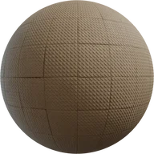
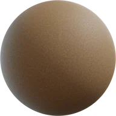
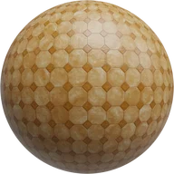
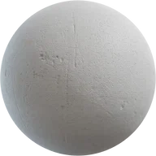
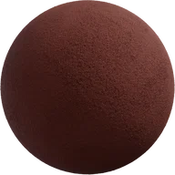
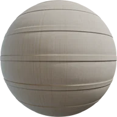

# Poly Haven: Plastic & Rubber textures

**8 assets from [Poly Haven](https://polyhaven.com), dedicated to the public domain under [CC0](https://polyhaven.com/license).** Use them in any game, free or paid, and change them however you like; no credit is needed.

PBR textures as 1K and 2K JPG maps (colour, normal (GL and DX), roughness, AO, displacement and more). 176.2 MB in all.

This is a copy kept by [zuujis-cc0](https://github.com/zuujis-cc0) so game makers can take single files from GitHub. It is not made by or affiliated with Poly Haven: the originals, often in more formats and higher resolutions, are on [polyhaven.com](https://polyhaven.com). If they help you, consider [supporting Poly Haven](https://www.patreon.com/polyhaven/overview).

Every file is listed in [MANIFEST.tsv](MANIFEST.tsv) with its size and SHA-256. More free assets: [the Zuujis collection](https://github.com/zuujis-cc0/free-game-assets#readme).

| | | | |
| :-: | :-: | :-: | :-: |
|  <b><a href="dashed_anti_skid_tiles">Dashed Anti Skid Tiles</a></b> by Amal Kumar · <a href="https://polyhaven.com/a/dashed_anti_skid_tiles">source</a> |  <b><a href="linoleum_brown">Linoleum Brown</a></b> by Rob Tuytel · <a href="https://polyhaven.com/a/linoleum_brown">source</a> |  <b><a href="old_linoleum_flooring_01">Old Linoleum Flooring 01</a></b> by Charlotte Baglioni · <a href="https://polyhaven.com/a/old_linoleum_flooring_01">source</a> |  <b><a href="polystyrene">Polystyrene</a></b> by Dario Barresi, Dimitrios Savva · <a href="https://polyhaven.com/a/polystyrene">source</a> |
|  <b><a href="rubber_tiles">Rubber Tiles</a></b> by Amal Kumar · <a href="https://polyhaven.com/a/rubber_tiles">source</a> |  <b><a href="rubberized_track">Rubberized Track</a></b> by Charlotte Baglioni · <a href="https://polyhaven.com/a/rubberized_track">source</a> |  <b><a href="running_track">Running Track</a></b> by Dimitrios Savva, Rico Cilliers · <a href="https://polyhaven.com/a/running_track">source</a> |  <b><a href="weathered_pvc_tank">Weathered Pvc Tank</a></b> by Amal Kumar · <a href="https://polyhaven.com/a/weathered_pvc_tank">source</a> |

---

Kept up to date by this repository's own [update workflow](.github/workflows/update.yml), with code and plan from [cc0-mirror](https://github.com/zuujis-cc0/cc0-mirror). Something wrong? [Open an issue there](https://github.com/zuujis-cc0/cc0-mirror/issues/new) or use the [private report form](https://games.zuujis.com/report).
